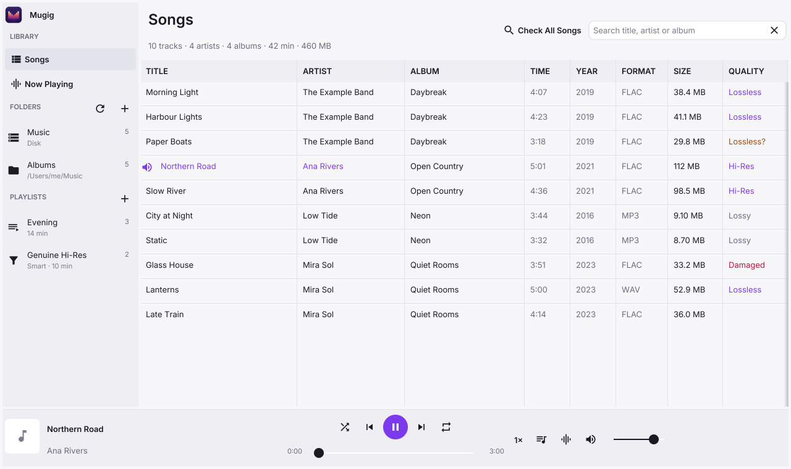
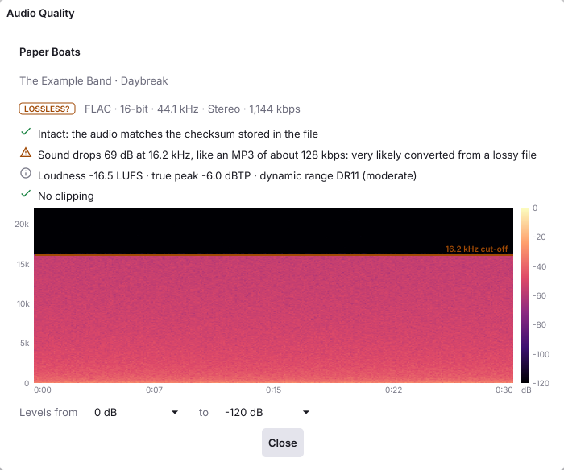

# Mugig

A desktop music player that also tells you the truth about your files: whether
a "lossless" FLAC really is lossless, whether it is intact, and how loud it is.
Written in Go with [Fyne](https://fyne.io).

<picture>
  <source media="(prefers-color-scheme: dark)" srcset="docs/images/songs-dark.png">
  
</picture>

## Features

### Playing

- Plays **FLAC, MP3, WAV and Ogg Vorbis**, and on macOS **M4A**: Apple
  Lossless (ALAC) and AAC, through the system's own decoder. The format is
  read from the file's own bytes, so misnamed files still play. Apple
  Lossless files get the quality check too, without a checksum to compare,
  as WAV files.
- **Bit-perfect playback**: the output is opened at each track's sample rate,
  and on macOS the device itself is switched to that rate (and put back on
  quit), so the audio reaches it unconverted. The Now Playing page says
  whether it is.
- **Gapless**: songs at the same sample rate follow each other without a
  pause, so live albums, classical works and mixes play as recorded. MP3s
  have the silence their encoder added cut off.
- **Gentle on the ears**: playing or resuming fades in over a second, and
  pausing fades out over a quarter of a second (Controls → Fade In and
  Out, on unless turned off). Turning the volume up glides there rather
  than jumping, so a slip of the slider can't blast the music. Turning
  it down is immediate. At full volume the sound still passes through
  untouched.
- **Exclusive access** (macOS, Controls → Exclusive Access): while a song
  plays or is paused, Mugig has the device to itself, so no other app's
  sound or alert is mixed into the music or changes the device's rate.
  Stop gives it back. Off unless turned on.
- **Equalizer** (Controls → Equalizer…, ⌥⌘E): ten bands, each with its
  own frequency, gain and width, a low shelf and a high shelf at the
  ends, presets, and a graph of the result. Boosts are matched by turning
  the whole down, so loud music doesn't clip. Off or flat, the sound
  passes through untouched.
- **Crossfeed for headphones** (Controls → Crossfeed): each ear hears a
  little of the other channel, as from speakers, so music panned hard to
  one side doesn't sit inside one ear. Light, Medium and Strong are bs2b's
  presets.
- Choice of **output device**.
- **Playback speed** from 0.5× to 2× with the **pitch kept**. At 1× the audio
  passes through untouched.
- **Smooth on slow or failing disks**: decoding runs up to 3 seconds ahead, so
  a USB disk waking up or retrying a bad spot doesn't break up the sound.
- **Damaged FLAC files play to the end**: a corrupt frame is skipped (a short
  silence) instead of stopping the song.
- **Up Next**: right-click a song and choose **Play Next** or **Play Later**.
  Those songs play first, then the list carries on where it was. The queue
  button in the player bar lights up while songs are waiting and lists them.
- **Picks up where you left off**: reopen Mugig and the last song waits in the
  player bar, paused where you stopped, with Up Next as you left it. Press
  Play to carry on; nothing plays by itself.
- Shuffle, repeat, seeking, keyboard shortcuts, a spectrum or waveform
  **visualizer**, and on macOS the system's Now Playing controls and media keys.
- **Light and dark** appearance, following the system or chosen in
  View → Appearance.

### Library

- A library made of **several music folders**, on any mix of internal,
  removable and network disks. Click a folder in the sidebar to see just its
  songs; right-click it to rescan it, show it in Finder or remove it (the
  files are never touched).
- **Leaves out audio that isn't music**: the sounds inside apps and plug-ins
  (`.app`, `.bundle`, …), `node_modules`, hidden folders, the Trash and the
  Recycle Bin, and on macOS the Library folders. A folder you add yourself
  is always scanned.
- Remembers what it read, so rescans are quick. Watches each folder for
  changes. When a disk is unplugged, its folder stays listed as
  "Not connected" with its songs hidden, and it is scanned again as soon as
  the disk is back.
- **CUE sheets**: an album ripped to one big file, with a `.cue` sheet
  beside it, is listed song by song with the sheet's titles and artists,
  and plays without gaps, as on the CD. Sheets in Chinese, Japanese,
  Korean or Western Windows encodings are read too. A sheet that runs
  past the end of its file, as one kept beside a shorter rip can, lists
  only the songs that are there. The songs share the file's quality
  check; Move to Trash is off for them, as it would take the whole album.
- **Playlists**: right-click songs and choose **Add to Playlist**, or save
  Up Next as one. A playlist plays in its own order; right-click a song in
  it to take it out or move it up or down. **Smart playlists** are rules
  instead, such as "Format is FLAC and Quality is Lossless?" or "File Date
  is in the last 30 days", by title, artist, album, year, format, quality,
  time, size, folder or file date, and keep themselves up to date. The +
  beside Playlists makes either kind; right-click one to play, edit, rename,
  duplicate or delete it, or **Export as M3U** for other players (songs
  beside the playlist file are saved relative to it, so a playlist kept on
  a USB disk works wherever the disk goes; songs from CUE sheets are left
  out, as M3U can only name whole files). Songs moved to the Trash leave
  the playlists.
- Add folders with the **+** beside Folders, the Open panel, or by dropping
  them on the window. Audio files opened or dropped are played.
- Search, and sort by any column: title, artist, album, **time**, year,
  format, **size**, **quality** or path. The line under the title totals the
  songs shown: tracks, artists, albums, listening time and size.
  **Show or hide columns** by right-clicking a column header, or in
  View → Columns.
- **Select several songs** with ⌘-click (Ctrl-click on Windows and Linux),
  ⇧-click for a run of them, or ⌘A for the whole list. Right-click them to
  play them, queue them, check their quality or copy their paths; the line
  under the title totals them. A plain click still plays a song.
- Right-click a song to **Play Next**, **Play Later**, **Get Info**, **Check Audio Quality**, **Show in
  Finder** (Explorer on Windows, the file manager on Linux), **Copy File
  Path** or **Move to Trash** (asks first; the file can be put back from the
  Trash, which on a USB disk is that disk's own).

### Audio quality check

<picture>
  <source media="(prefers-color-scheme: dark)" srcset="docs/images/quality-dark.png">
  
</picture>

Right-click a song and choose **Check Audio Quality…** (⌘I for the playing
song), or **Check All Songs** to check the whole library in the background.
Results are saved, so each file is only ever checked once (until it changes).

- **Integrity**: decodes the whole file and compares it with the MD5 checksum
  stored in FLAC files; finds WAV files cut short. If Mugig's FLAC decoder
  fails, the file is re-read with the macOS decoder for a second opinion.
- **Lossy source**: finds files converted from MP3 or AAC, by the encoder's
  frequency cut-off and the gaps lossy encoders leave in the spectrum. The
  wording says how strong the evidence is ("very likely" or "probably"),
  rather than giving a made-up percentage.
- **Fake hi-res**: finds 24-bit files padded from 16 bits, and 96 kHz files
  upsampled from CD quality.
- **Loudness and peaks**: integrated loudness (ITU-R BS.1770-4, in LUFS), true
  peak, the DR dynamic range figure, and clipping.
- **Spectrogram**, with a colour legend and an adjustable range of levels, and
  the cut-off marked.

How well it works, measured on a real library of 833 files: the lossy-source
test flagged 93% of MP3s decoded to 16-bit files, and 1.6% of genuine lossless
files. Treat a "Lossless?" verdict as a reason to look at the spectrogram, not
as proof.

## Building

You need [Go](https://go.dev/dl/) 1.24 or later and a C compiler, as Fyne and
the audio output use C:

| System | C compiler and libraries |
|---|---|
| macOS | Xcode's command line tools: `xcode-select --install` |
| Linux (Debian, Ubuntu) | `sudo apt install gcc libgl1-mesa-dev xorg-dev` |
| Windows | A MinGW-w64 GCC, for example from [MSYS2](https://www.msys2.org) |

Then:

```sh
make run        # build and run
make test       # run the tests (with the race detector)
make package    # build the app for this computer (Mugig.app on macOS)
make install    # macOS: package and copy into /Applications
make fuzz       # feed corrupt files to every file reader, a minute each
```

A few tests touch the real system, so they only run when asked:

```sh
MUGIG_HOG_TEST=1 go test ./internal/audio -run 'Hog|Exclusive'   # takes the default output for a moment (macOS)
MUGIG_TRASH_TEST=1 go test ./internal/trash                      # puts a test file in the Trash
```

### Builds for other systems

These collect their results in `dist/`:

```sh
make mac             # one app for Apple silicon and Intel Macs
make mac-arm64       # Apple silicon only
make mac-intel       # Intel Macs only
make windows         # Windows (Intel/AMD); also windows-arm64
make linux           # Linux (Intel/AMD); also linux-arm64
make all-platforms   # mac, windows and linux
```

The Windows and Linux builds use [fyne-cross](https://github.com/fyne-io/fyne-cross),
which needs **Docker** running; the first build of each downloads a build image
of 1–2 GB.

### Platform notes

Mugig is developed and tested on macOS. On Windows and Linux it builds and
should work, but has had far less use. These are macOS only: switching the
device's sample rate, the system's Now Playing controls, the native Open panel
(which lists all disks), and the macOS decoder used as a second opinion.

## Keyboard shortcuts

⌘ is Ctrl on Windows and Linux.

| Keys | Action |
|---|---|
| Space | Play / pause |
| ⌘-click / ⇧-click | Select songs / a run of songs |
| ⌘A / Esc | Select every song listed / clear the selection |
| ⌘→ / ⌘← | Next / previous song |
| ⌥⌘→ / ⌥⌘← | Skip forward / back 10 seconds |
| ⌘↑ / ⌘↓ | Volume up / down |
| ⌥⌘↓ | Mute |
| ⌘] / ⌘[ | Faster / slower |
| ⌥⌘E | Equalizer |
| ⌘. | Stop |
| ⌘F | Find |
| ⌘L | Visualizer |
| ⌘I | Check the playing song's audio quality |
| ⇧⌘I | Check all songs |
| ⌘O / ⇧⌘O | Open files / add a music folder |
| ⌘R | Rescan the folders |
| ⇧⌘R | Show the playing song in Finder |

## Project layout

`main.go` only starts the app; the code is in packages under `internal/`,
each with its own tests. They depend on each other in one direction only:
`ui` uses `library`, `quality` and `audio`; `library` uses `quality` (for
smart playlists' rules) and `audio`; `quality` uses `audio`; `audio` uses
none of them.

| Folder | What it does |
|---|---|
| `internal/ui` | The window, made with Fyne: sidebar, song list, player bar, Now Playing, the quality window, the equalizer, menus, keyboard, and the macOS Now Playing, Open panel, Finder and Dock |
| `internal/library` | Finding songs: walking folders (leaving out what isn't music), tags, lengths, the saved library, CUE sheets, watching folders, cover art, playlists and smart playlists' rules |
| `internal/audio` | Reading and playing audio: formats, decoding (with damaged FLAC played past the damage), gapless playback, read-ahead, speed, equalizer, crossfeed, volume, the output device, and on macOS CoreAudio and the system decoder |
| `internal/quality` | The quality check: integrity, lossy source, fake hi-res, loudness and peaks, the spectrogram's analysis, verdicts, and the saved results |
| `internal/trash` | Move to Trash, with each system's own Trash |
| `internal/humanize`, `internal/gobfile` | Wording numbers ("1,204 songs", "38.2 MB"); saving files safely |
| `internal/audiotest` | Test audio: shaped noise, FLAC and WAV files, CUE albums, the sample files in `testdata` |
| `tools/mkicon` | Draws the app icon (`make icon`) |
| `docs/goui.md` | Lessons learned building a Go and Fyne app |

## License

Mugig is free software under the [MIT License](LICENSE): use it, change it
and share it as you like, keeping the copyright notice. The bundled Inter
font has its own licence, the SIL Open Font License.

## Credits

- The UI font is [Inter](https://rsms.me/inter/), under the SIL Open Font
  License (`internal/ui/fonts/LICENSE-Inter.txt`).
- Crossfeed follows Boris Mikhaylov's design in
  [bs2b](https://bs2b.sourceforge.net/), with its presets by Chu Moy and
  Jan Meier.
- The idea of measuring loudness and peaks alongside the quality check comes
  from [AudioAuditor](https://github.com/Angel2mp3/AudioAuditor) (Apache 2.0);
  the code follows the published standards.
- Built on [Fyne](https://fyne.io), [beep](https://github.com/gopxl/beep),
  [malgo](https://github.com/gen2brain/malgo) (miniaudio),
  [mewkiz/flac](https://github.com/mewkiz/flac) and
  [dhowden/tag](https://github.com/dhowden/tag).
