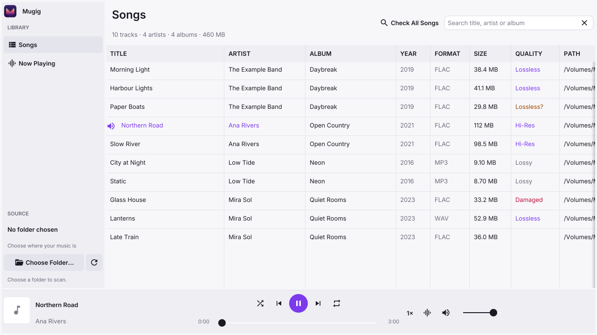
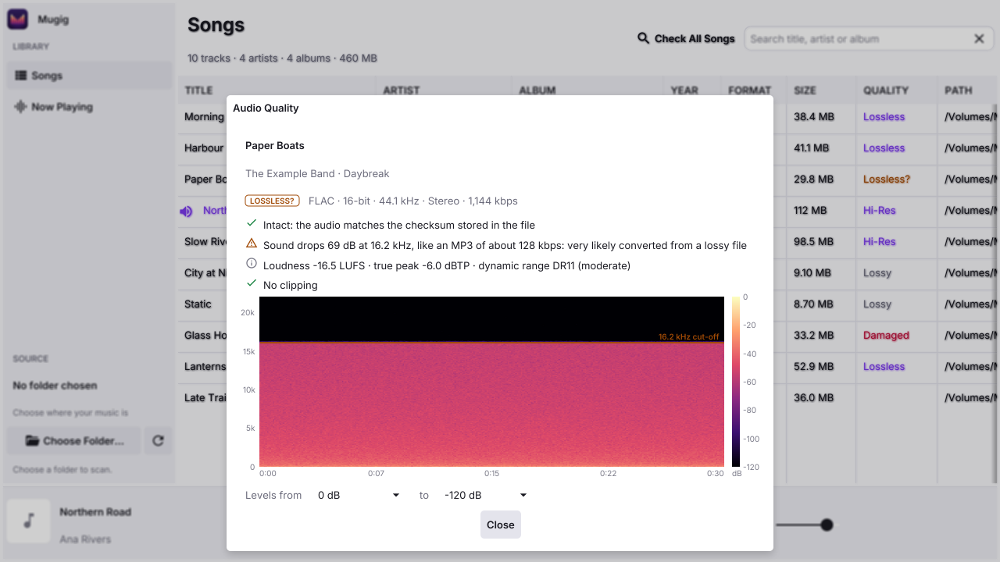

# Mugig

A desktop music player that also tells you the truth about your files: whether
a "lossless" FLAC really is lossless, whether it is intact, and how loud it is.
Written in Go with [Fyne](https://fyne.io).

<picture>
  <source media="(prefers-color-scheme: dark)" srcset="docs/screenshot-songs-dark.png">
  
</picture>

## Features

### Playing

- Plays **FLAC, MP3, WAV and Ogg Vorbis**. The format is read from the file's
  own bytes, so misnamed files still play.
- **Bit-perfect playback**: the output is opened at each track's sample rate,
  and on macOS the device itself is switched to that rate (and put back on
  quit), so the audio reaches it unconverted. The Now Playing page says
  whether it is.
- Choice of **output device**.
- **Playback speed** from 0.5× to 2× with the **pitch kept**. At 1× the audio
  passes through untouched.
- **Smooth on slow or failing disks**: decoding runs up to 3 seconds ahead, so
  a USB disk waking up or retrying a bad spot doesn't break up the sound.
- **Damaged FLAC files play to the end**: a corrupt frame is skipped (a short
  silence) instead of stopping the song.
- Shuffle, repeat, seeking, keyboard shortcuts, a spectrum or waveform
  **visualizer**, and on macOS the system's Now Playing controls and media keys.
- **Light and dark** appearance, following the system or chosen in
  View → Appearance.

### Library

- A library made of **several music folders**, on any mix of internal,
  removable and network disks. Click a folder in the sidebar to see just its
  songs; right-click it to rescan it, show it in Finder or remove it (the
  files are never touched).
- Remembers what it read, so rescans are quick. Watches each folder for
  changes. When a disk is unplugged, its folder stays listed as
  "Not connected" with its songs hidden, and it is scanned again as soon as
  the disk is back.
- Add folders with the **+** beside Folders, the Open panel, or by dropping
  them on the window. Audio files opened or dropped are played.
- Search, and sort by any column: title, artist, album, year, format, **size**,
  **quality** or path.
- Right-click a song to **Get Info**, **Check Audio Quality**, **Show in
  Finder** (Explorer on Windows, the file manager on Linux) or **Copy File
  Path**.

### Audio quality check

<picture>
  <source media="(prefers-color-scheme: dark)" srcset="docs/screenshot-quality-dark.png">
  
</picture>

Right-click a song and choose **Check Audio Quality…** (⌘I for the playing
song), or **Check All Songs** to check the whole library in the background.
Results are saved, so each file is only ever checked once (until it changes).

- **Integrity**: decodes the whole file and compares it with the MD5 checksum
  stored in FLAC files; finds WAV files cut short. If Mugig's FLAC decoder
  fails, the file is re-read with the macOS decoder for a second opinion.
- **Lossy source**: finds files converted from MP3 or AAC, by the encoder's
  frequency cut-off and the gaps lossy encoders leave in the spectrum. The
  wording says how strong the evidence is ("very likely" or "probably"),
  rather than giving a made-up percentage.
- **Fake hi-res**: finds 24-bit files padded from 16 bits, and 96 kHz files
  upsampled from CD quality.
- **Loudness and peaks**: integrated loudness (ITU-R BS.1770-4, in LUFS), true
  peak, the DR dynamic range figure, and clipping.
- **Spectrogram**, with a colour legend and an adjustable range of levels, and
  the cut-off marked.

How well it works, measured on a real library of 833 files: the lossy-source
test flagged 93% of MP3s decoded to 16-bit files, and 1.6% of genuine lossless
files. Treat a "Lossless?" verdict as a reason to look at the spectrogram, not
as proof.

## Building

You need [Go](https://go.dev/dl/) 1.24 or later and a C compiler, as Fyne and
the audio output use C:

| System | C compiler and libraries |
|---|---|
| macOS | Xcode's command line tools: `xcode-select --install` |
| Linux (Debian, Ubuntu) | `sudo apt install gcc libgl1-mesa-dev xorg-dev` |
| Windows | A MinGW-w64 GCC, for example from [MSYS2](https://www.msys2.org) |

Then:

```sh
make run        # build and run
make test       # run the tests (with the race detector)
make package    # build the app for this computer (Mugig.app on macOS)
make install    # macOS: package and copy into /Applications
```

### Builds for other systems

These collect their results in `dist/`:

```sh
make mac             # one app for Apple silicon and Intel Macs
make mac-arm64       # Apple silicon only
make mac-intel       # Intel Macs only
make windows         # Windows (Intel/AMD); also windows-arm64
make linux           # Linux (Intel/AMD); also linux-arm64
make all-platforms   # mac, windows and linux
```

The Windows and Linux builds use [fyne-cross](https://github.com/fyne-io/fyne-cross),
which needs **Docker** running; the first build of each downloads a build image
of 1–2 GB.

### Platform notes

Mugig is developed and tested on macOS. On Windows and Linux it builds and
should work, but has had far less use. These are macOS only: switching the
device's sample rate, the system's Now Playing controls, the native Open panel
(which lists all disks), and the macOS decoder used as a second opinion.

## Keyboard shortcuts

⌘ is Ctrl on Windows and Linux.

| Keys | Action |
|---|---|
| Space | Play / pause |
| ⌘→ / ⌘← | Next / previous song |
| ⌥⌘→ / ⌥⌘← | Skip forward / back 10 seconds |
| ⌘↑ / ⌘↓ | Volume up / down |
| ⌥⌘↓ | Mute |
| ⌘] / ⌘[ | Faster / slower |
| ⌘. | Stop |
| ⌘F | Find |
| ⌘L | Visualizer |
| ⌘I | Check the playing song's audio quality |
| ⇧⌘I | Check all songs |
| ⌘O / ⇧⌘O | Open files / add a music folder |
| ⌘R | Rescan the folders |
| ⇧⌘R | Show the playing song in Finder |

## Project layout

| Files | What they do |
|---|---|
| `main.go`, `layout.go`, `theme.go` | The window, its layout and the theme |
| `library.go`, `folders.go`, `folderview.go`, `cache.go`, `watch*.go`, `drive*.go` | Scanning, the music folders, the saved library, folder watching |
| `player.go`, `output.go`, `readahead.go`, `flacplay.go`, `stretch.go` | Decoding, read-ahead, damage-tolerant FLAC, speed, audio output |
| `quality.go`, `levels.go`, `spectrogram.go`, `batch.go` | The quality check, loudness, spectrograms, Check All Songs |
| `*_darwin.go`, `*_darwin.m` | macOS parts: CoreAudio, Now Playing, Open panel, Finder, Dock |
| `tools/mkicon` | Draws the app icon (`make icon`) |
| `docs/goui.md` | Lessons learned building a Go and Fyne app |

## Credits

- The UI font is [Inter](https://rsms.me/inter/), under the SIL Open Font
  License (`fonts/LICENSE-Inter.txt`).
- The idea of measuring loudness and peaks alongside the quality check comes
  from [AudioAuditor](https://github.com/Angel2mp3/AudioAuditor) (Apache 2.0);
  the code follows the published standards.
- Built on [Fyne](https://fyne.io), [beep](https://github.com/gopxl/beep),
  [malgo](https://github.com/gen2brain/malgo) (miniaudio),
  [mewkiz/flac](https://github.com/mewkiz/flac) and
  [dhowden/tag](https://github.com/dhowden/tag).
